# Data warehouse da Cota Parlamentar no GCP


Data warehouse com as despesas da **Cota para o Exercício da Atividade Parlamentar (CEAP)**
da Câmara dos Deputados, de 2019 a 2026: **1,69 milhão de lançamentos** modelados em esquema
estrela no **BigQuery** com **dbt**, ingeridos diariamente por um **Cloud Run Job** e
visualizados no **Looker Studio**. Toda a infraestrutura é criada com **Terraform**.

**[Dashboard ao vivo](https://lookerstudio.google.com/reporting/9ae699ad-eb0b-4f8c-8cb6-9d6de5edc96b)** ·
**[Documentação do dbt](https://pedrosilva8140.github.io/gcp-dw-cota-parlamentar/dbt/)**

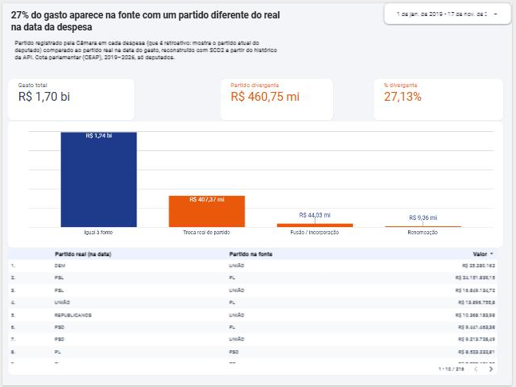

## O achado principal

O arquivo da CEAP traz o partido de cada despesa, mas esse campo é **retroativo**: mostra o
partido **atual** do deputado, não o da data do gasto. O UNIÃO, fundado em 2022, aparece em
despesas de 2019.

Reconstruindo o partido real na data de cada despesa (SCD tipo 2 a partir do histórico da
API), **R$ 460,8 mi (27%)** do gasto de deputados aparece na fonte com um partido diferente:

| Classificação | Lançamentos | Valor | % do valor |
| --- | ---: | ---: | ---: |
| Igual à fonte | 1.221.569 | R$ 1.237,3 mi | 72,9% |
| Troca real de partido | 396.249 | R$ 407,4 mi | 24,0% |
| Fusão ou incorporação | 49.519 | R$ 44,0 mi | 2,6% |
| Renomeação | 12.198 | R$ 9,4 mi | 0,6% |

Renomeações (PMDB → MDB) e fusões (DEM + PSL → UNIÃO) são separadas das trocas reais com uma
tabela de sucessões partidárias validada em fontes do TSE. Quem analisa gasto por partido
usando o campo da fonte atribui um quarto do dinheiro a um partido diferente do real.

## Arquitetura

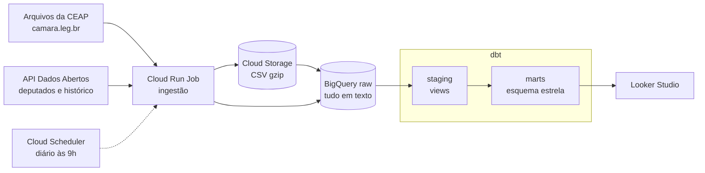

## Stack

| Ferramenta | Uso | Por que escolhi |
| --- | --- | --- |
| **Cloud Run Jobs** | Ingestão em container | Serverless para tarefas batch: paga só durante a execução |
| **Cloud Scheduler** | Agendamento diário | Dispara o job com OAuth de uma conta de serviço dedicada |
| **Cloud Storage** | Camada raw em arquivo | Guarda o CSV original para reprocessamento |
| **BigQuery** | Data warehouse | Colunar, serverless, com particionamento e clustering |
| **dbt** | Transformações e testes | SQL versionado, testes de dados e documentação com linhagem |
| **Looker Studio** | Dashboard | Conecta direto no BigQuery, sem servidor |
| **Terraform** | Infraestrutura como código | Bucket, datasets, contas de serviço, permissões e agendamento |
| **GitHub Actions** | CI | `ruff`, `dbt parse` e validação do Terraform a cada push |

## Modelagem

| Camada | Conteúdo | Materialização |
| --- | --- | --- |
| **raw** | Dados como a fonte entrega, todas as colunas em texto | Tabelas (carga com `WRITE_TRUNCATE`) |
| **staging** | Limpeza e tipagem, sem regra de negócio | Views |
| **marts** | `fct_despesas` + `dim_deputado` (SCD2), `dim_fornecedor`, `dim_tipo_despesa`, `dim_data` e relatórios | Tabelas |

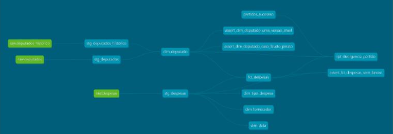

## Decisões técnicas

- **Grão de lançamento com chave substituta.** O `ideDocumento` da fonte não é único (47.994
  duplicados). A chave `lancamento_id` é um hash da linha original inteira, com desempate pela
  ordem de ocorrência.
- **SCD tipo 2 a partir de um log de eventos.** A `dim_deputado` é construída com o histórico da
  API (`/deputados/{id}/historico`): um evento por dia, só as mudanças de partido ou UF
  (*gaps and islands* com `LAG`/`LEAD`), validade semiaberta `[valido_de, valido_ate)` e primeira
  versão válida desde sempre.
- **Join "ponto no tempo".** Cada despesa é ligada à versão do deputado vigente na data do gasto,
  com um teste que garante que o join não multiplica linhas.
- **Regra de negócio num lugar só.** A classificação da divergência fica em um model
  intermediário (`int_despesas_classificadas`, efêmero), usado pelo relatório agregado e pela
  tabela do dashboard.
- **Fato particionada por mês de competência** e clusterizada por tipo de despesa e deputado.
- **Raw em texto, tipagem no dbt.** A ingestão não aplica filtros nem conversões: toda regra
  fica no dbt, versionada e testada.
- **Ingestão idempotente.** Cada ano sobrescreve sua tabela (`WRITE_TRUNCATE`) e seu arquivo.
- **Menor privilégio.** Três contas de serviço: ingestão (só o bucket e o dataset `raw`),
  build da imagem e agendador (só pode executar o job).
- **LGPD.** O nome do passageiro é descartado no staging, o CPF de fornecedor pessoa física
  nunca é exposto, e o dashboard mostra só fornecedores pessoa jurídica.

## Qualidade de dados

**40 testes de dados** rodam no `dbt build`: unicidade e não nulos nas chaves, integridade
referencial entre fato e dimensões, valores aceitos nas classificações e três testes específicos:

1. **Uma versão atual por deputado** na `dim_deputado`
2. **Regressão com caso real:** Fausto Pinato ficou no PP até 29/04/2026 e está no UNIÃO desde então
3. **Sem fan-out:** a fato tem exatamente o mesmo número de linhas do staging

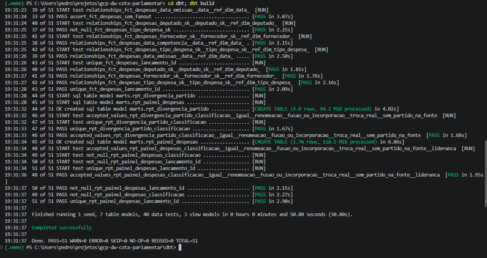

## Custo das consultas

Mesma pergunta (gasto de 2023) respondida de jeitos diferentes, comparando o que o BigQuery
estima no *dry run* com o que ele realmente processa ([`scripts/custo_consultas.py`](scripts/custo_consultas.py)):

| Consulta | Estimado | Processado |
| --- | ---: | ---: |
| Staging, só a coluna de valor | 21,8 MB | 21,8 MB |
| Staging, usando `lancamento_id` | 537 MB | 537 MB |
| Fato, filtro em coluna correlacionada à partição | 40,5 MB | 5,6 MB |
| Fato, filtro na partição | 5,6 MB | 5,6 MB |
| Fato, partição + cluster | 7,4 MB | 7,4 MB |
| Fato, filtro em coluna não correlacionada | 40,5 MB | 40,5 MB |

Comportamentos observados:

- **A poda de colunas atravessa views.** Consultar só o valor no staging lê 21,8 MB; pedir a
  chave substituta (um hash da linha inteira) obriga a ler todas as colunas: 537 MB.
- **O dry run é um teto.** Com um filtro em coluna correlacionada à partição, o BigQuery
  descartou blocos na execução e leu 7× menos que o estimado.
- **Clustering não ajudou em partições pequenas.** Com partições de ~3,7 MB, o cluster não
  reduziu a leitura.
- Toda consulta é cobrada em no mínimo **10 MB**.

## Evidências

| | |
| --- | --- |
| Evolução mensal | 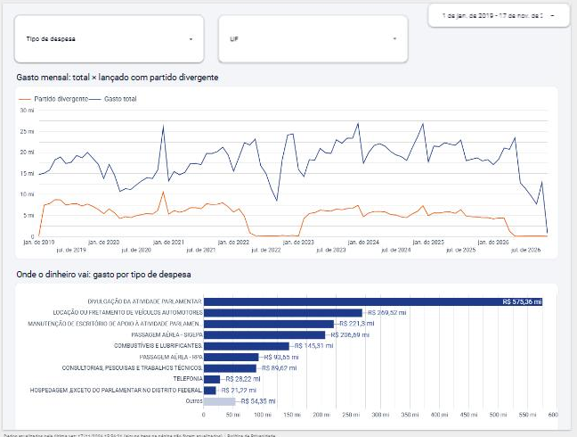 |
| Maiores fornecedores (só PJ) | 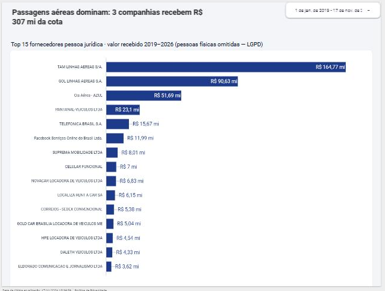 |
| Camada raw no Cloud Storage | 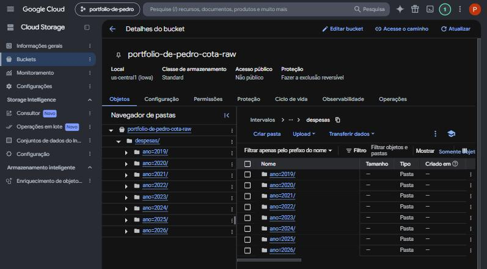 |
| Datasets no BigQuery | 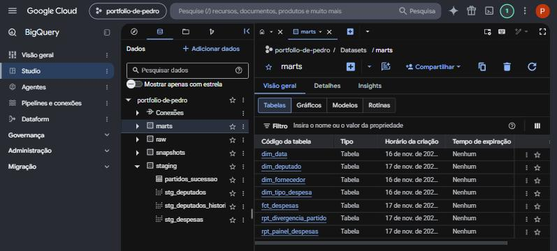 |
| Fato particionada e clusterizada | 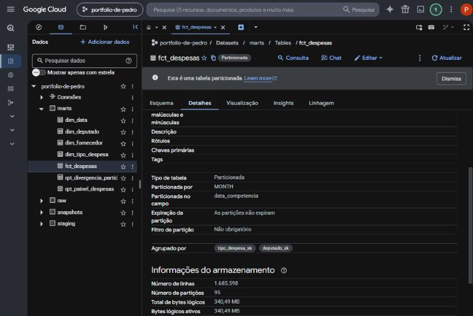 |
| Execuções diárias do job | 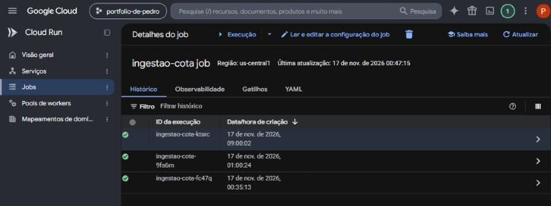 |
| CI | 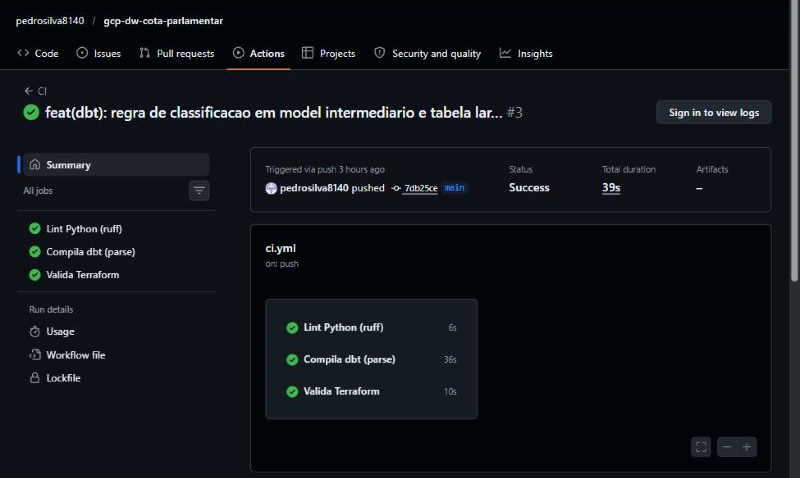 |

## Custo do projeto

Tudo roda dentro das cotas gratuitas do GCP: ~**R$ 0/mês**. A fato tem ~340 MB, o job diário
leva ~14 minutos com 1 GiB de memória, e o dashboard usa cache de 12 horas.

## Como rodar

Pré-requisitos: projeto no GCP, `gcloud` autenticado (`gcloud auth application-default login`),
Terraform e Python 3.12.

```bash
# 1. Infraestrutura
cd infra
terraform init
terraform apply

# 2. Ingestão local (ou pelo Cloud Run Job)
pip install -r ingestao/requirements.txt
python ingestao/main.py --anos 2019 2020 2021 2022 2023 2024 2025 2026

# 3. Transformações e testes
cd dbt
pip install -r requirements.txt
dbt build

# 4. Documentação
dbt docs generate --static
```

## Estrutura

```text
├── infra/            # Terraform: bucket, datasets, contas de serviço, agendamento
├── ingestao/         # Job de ingestão (Python + Dockerfile)
├── dbt/
│   ├── models/       # staging e marts
│   ├── seeds/        # sucessões partidárias
│   └── tests/        # testes específicos (SCD2, fan-out)
├── scripts/          # medição de custo das consultas
├── docs/             # prints e documentação do dbt (GitHub Pages)
└── .github/workflows # CI
```

## Limitações e próximos passos

- **Sucessões de um passo só.** A tabela de sucessões compara o partido real com o da fonte
  diretamente; cadeias longas (A → B → C) podem cair em "troca real".
- **Mês corrente parcial:** o último mês contém só as despesas já publicadas.
- **Histórico só dos deputados presentes nas despesas:** a API é consultada para os IDs que
  aparecem nos dados, não para todos os deputados da história.
- **Datas fora do período:** há um lançamento com emissão em 2002, mantido como veio da fonte.
- Orquestrar com **Airflow** (próximo projeto do portfólio).
